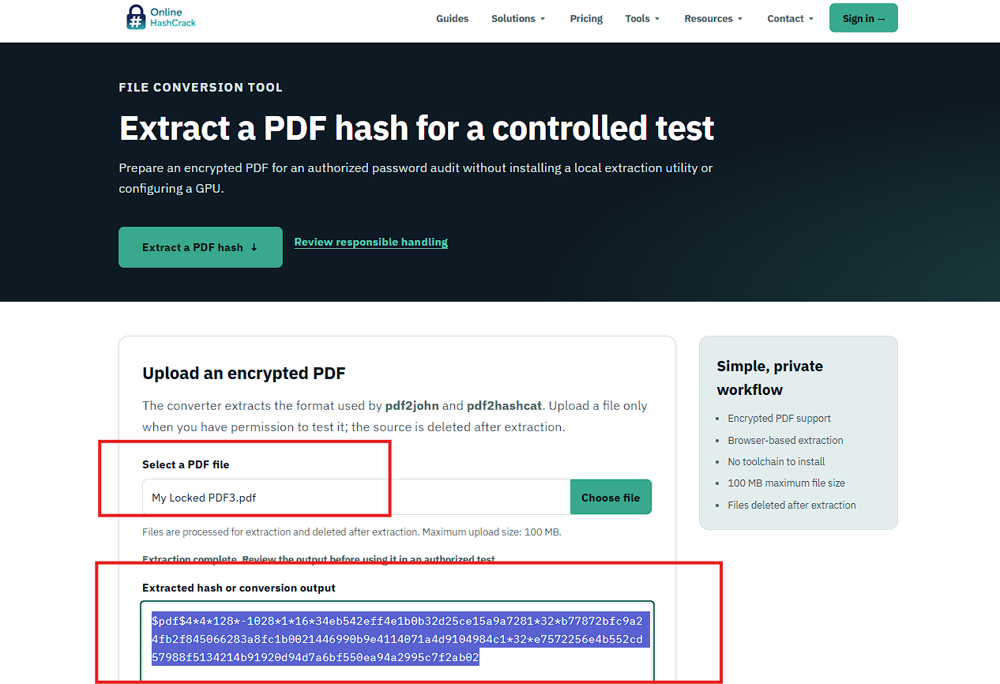
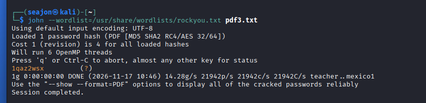
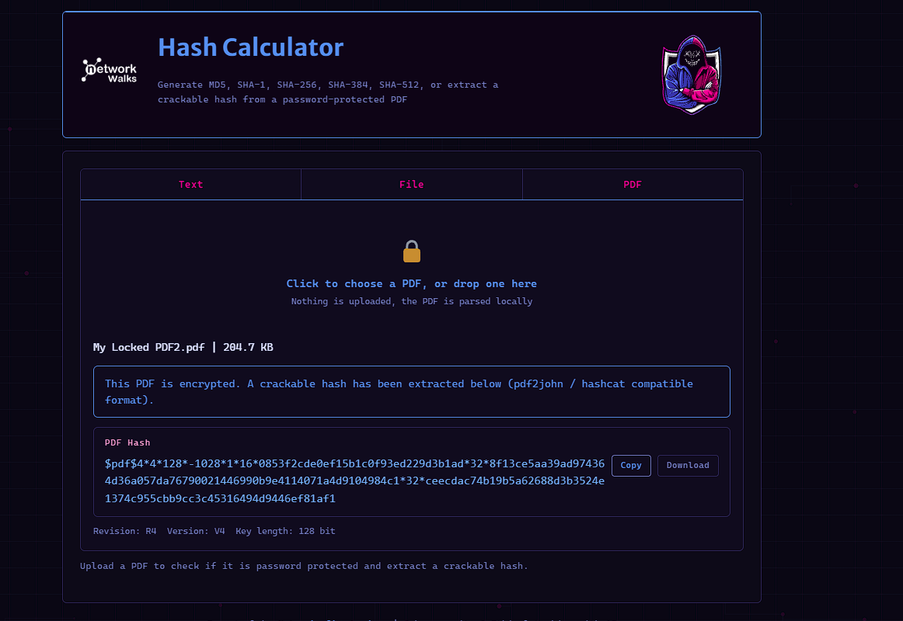
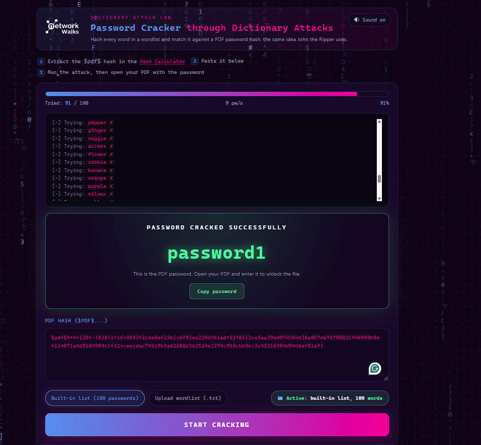

# 🔐 Password Cracking – Week 3

### Cybersecurity Internship | Practical Hands-on Experience


**Exploring Password Security, PDF Hash Extraction & Dictionary-Based Attacks**

---

## 📌 About This Project

This repository showcases my **Week 3 Cybersecurity Internship practical tasks**, focused on password cracking, PDF hash extraction, and dictionary-based password auditing.

I completed two hands-on practical tasks using **John the Ripper (JTR)** and **NetworkWalks Tools** in controlled lab environments.

The exercises provided practical experience in password hash extraction, wordlist-based attacks, and password security assessment.

## 🛠️ Tools & Technologies


| Tool | Purpose |
|---|---|
| Kali Linux | Linux cybersecurity environment |
| John the Ripper | Password hash auditing |
| RockYou Wordlist | Dictionary-based password testing |
| NetworkWalks Hash Calculator | PDF hash extraction |
| NetworkWalks Dictionary Attack Lab | Password cracking exercises |

---

## 🎯 Weekly Task Overview

| Task ID | Task | Status |
|---|---|---|
| W3-PM1 | Password Cracking with John the Ripper | ✅ Completed |
| W3-PM2 | Password Cracking with NetworkWalks Tools | ✅ Completed |

---

# 🔓 W3-PM1: Password Cracking with John the Ripper

### 🎯 Objectives

- Understand password hashing.
- Extract hashes from encrypted PDF files.
- Learn John the Ripper usage.
- Perform dictionary attacks.
- Use the RockYou wordlist.

### ⚙️ Practical Implementation

**1. PDF Hash Extraction**

Extracted a crackable hash from an encrypted PDF using an online PDF hash extraction tool for an authorized lab exercise.

**2. Dictionary Attack**

Executed the following command in Kali Linux:

```bash
john --wordlist=/usr/share/wordlists/rockyou.txt pdf3.txt
```

**3. Result**

- Successfully loaded the PDF hash.
- Executed the dictionary attack.
- Identified a matching password candidate.
- Successfully completed the practical exercise.

### 📸 Screenshots & Evidence

**01. PDF Hash Extraction**



**02. John the Ripper Terminal Output**



**03. JTR Practical Completion Evidence**


**04. JTR Practical Completion Evidence**


---

# 🌐 W3-PM2: Password Cracking with NetworkWalks Tools

### 🎯 Objectives

- Explore NetworkWalks cybersecurity tools.
- Understand PDF hash extraction.
- Practice dictionary-based password attacks.
- Analyze password-cracking results.
- Complete assigned lab exercises.

### ⚙️ Practical Implementation

**1. Hash Calculator**

Used the NetworkWalks Hash Calculator to extract a crackable hash from a password-protected PDF.

**2. Dictionary Attack**

Used the NetworkWalks Dictionary Attack Lab to test password candidates against the extracted hash.

**3. Result**

Successfully completed the assigned exercises and captured the lab flags.

### 📸 Screenshots & Evidence

**01. NetworkWalks Hash Calculator**



**02. Dictionary Attack Result**



**03. Lab Completion Evidence**


---

## 📚 Key Learning Outcomes

- Password hashing fundamentals.
- PDF password hash extraction.
- John the Ripper practical usage.
- RockYou wordlist utilization.
- Dictionary-based password attacks.
- NetworkWalks cybersecurity tools.
- Password security assessment.
- Understanding weak password vulnerabilities.

---

## 📁 Repository Structure

```text
Password-Cracking/
│
├── README.md
│
├── W3-PM1-John-The-Ripper/
│   ├── Screenshots/
│   ├── Commands.md
│   └── Findings.md
│
├── W3-PM2-NetworkWalks/
│   ├── Screenshots/
│   ├── Commands.md
│   └── Findings.md
│
├── Tools-Used.md
└── Key-Learnings.md
```

---

## ⚠️ Disclaimer

This repository is intended for educational and cybersecurity learning purposes only.

All activities were performed in authorized lab environments. Password-cracking techniques should only be used on systems and files for which explicit permission has been granted.

---

### 🚀 Week 3 – Successfully Completed

**Learn • Practice • Secure • Repeat**
